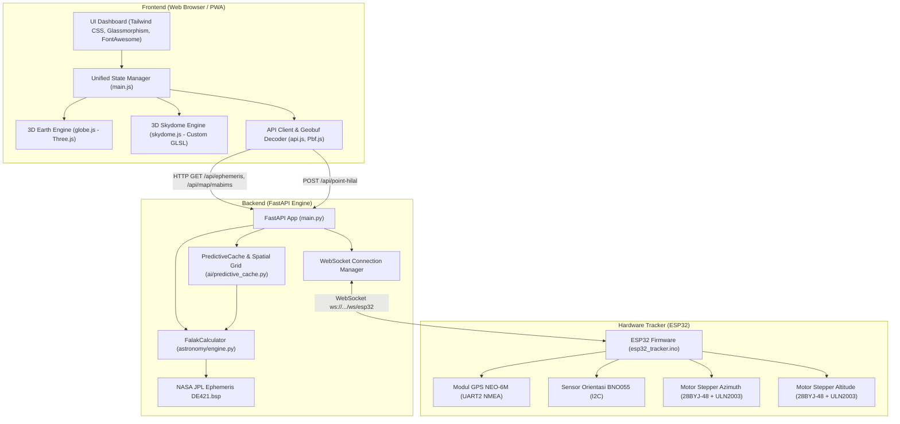
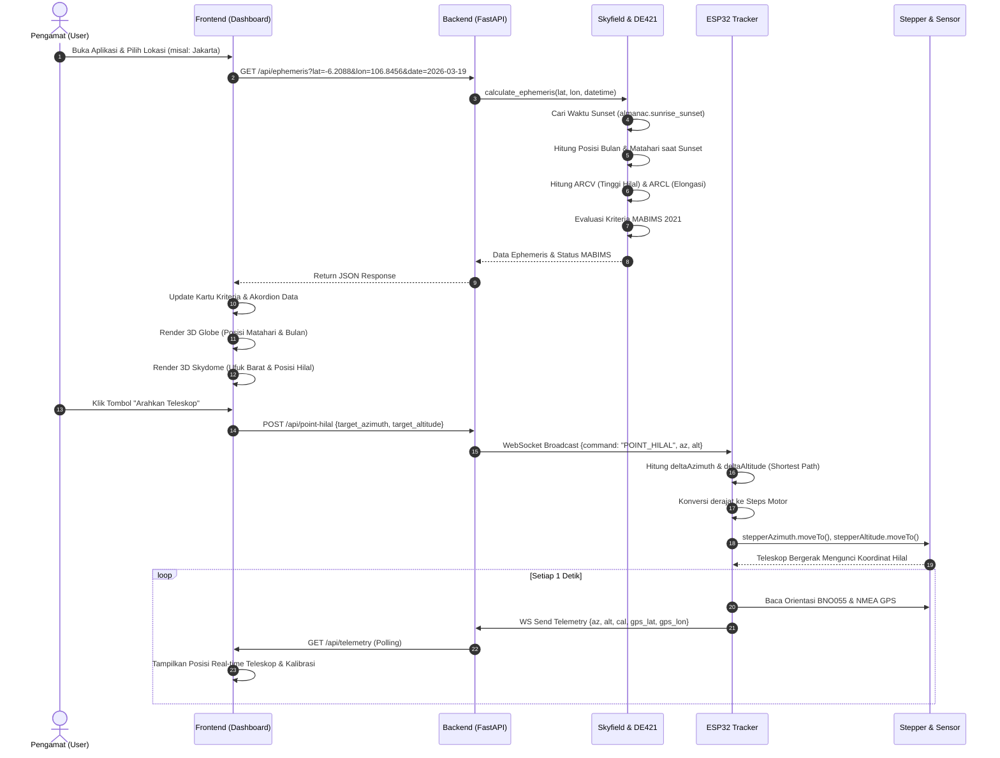

# HILTRON — Islamic Astronomical Observatory & Autonomous Hilal Tracker

> **Sistem Observatorium Astronomi Islam Berbasis Ephemeris NASA JPL DE421, Visualisasi 3D Interaktif (Three.js), dan Pelacak Hilal Otomatis Berbasis Mikrokontroler IoT (ESP32).**

---

## 1. Judul & Deskripsi Proyek

### 1.1 Apa itu HILTRON?
**HILTRON** (sebelumnya dikembangkan dengan nama *FalakHub*) adalah platform observatorium digital terintegrasi yang menggabungkan kalkulasi astronomi Islam (*ilmu falak*) berpresisi tinggi dengan teknologi visualisasi 3D modern serta perangkat keras pelacak (*tracker*) teleskop otomatis.

Platform ini mengintegrasikan tiga lapisan utama:
1. **Computational Backend Engine**: Komputasi ephemeris benda langit berskala ilmiah menggunakan kernel resmi **NASA JPL DE421** melalui pustaka **Skyfield** dan **Python FastAPI**.
2. **Interactive 3D Web Dashboard**: Antarmuka web modern dengan *glassmorphism UI*, memvisualisasikan bola bumi 3D fotorealistik (*Earth Globe*), fenomena optis atmosfer lokal (*3D Skydome* dengan *custom GLSL rayleigh shader*), dan sebaran visibilitas hilal global berbasis *Big Data spatial* (*Geobuf/Protocol Buffers*).
3. **IoT Autonomous Hilal Tracker (ESP32)**: Perangkat keras pengendali dudukan teleskop (*motorized pan-tilt mount*) berbasis ESP32, motor stepper presisi (28BYJ-48), sensor orientasi absolut 9-DOF (Bosch BNO055), modul GPS NEO-6M, serta komunikasi bi-directional secara *real-time* melalui WebSocket.

### 1.2 Masalah yang Diselesaikan
* **Ketidakpastian Hisab & Rukyat**: Penentuan awal bulan kamariah dalam kalender Hijriah (khususnya penentuan 1 Ramadan, 1 Syawal, dan 1 Zulhijah) sering mengalami perdebatan metodologis antara metode *hisab* (perhitungan matematis) dan *rukyat* (pengamatan langsung di lapangan). HILTRON menyatukan kedua pendekatan ini: menyediakan hisab berakurasi sub-detik busur serta membimbing proses rukyat secara langsung menggunakan instrumentasi pelacak otomatis.
* **Kompleksitas Evaluasi Kriteria MABIMS 2021**: Sejak diperkenalkannya kriteria visibilitas hilal baru MABIMS (Menteri Agama Brunei Darussalam, Indonesia, Malaysia, dan Singapura) tahun 2021 (tinggi hilal $\ge 3^\circ$ dan elongasi $\ge 6.4^\circ$), praktisi dan masyarakat membutuhkan alat visual yang cepat dan intuitif untuk memverifikasi apakah hilal berpotensi terlihat (*imkanur rukyat*) di titik observasi mana pun di dunia.
* **Human Error & Kesulitan Akuisisi Objek (Finding Crescent)**: Bulan sabit tipis (*hilal*) pasca terbenamnya matahari memiliki kontras iluminasi yang sangat tipis (< 1%) dan durasi visibilitas yang sangat singkat (seringkali hanya 10–30 menit sebelum hilal ikut terbenam). Mengarahkan teleskop secara manual sering memakan waktu lama hingga momentum hilang. HILTRON memungkinkan pengamat mengunci target hilal dengan 1 tombol (*Point Hilal*), di mana mikrokontroler langsung menggerakkan poros azimuth dan altitude teleskop tepat ke koordinat hilal.

---

## 2. Arsitektur & Struktur Proyek

### 2.1 Diagram Arsitektur Sistem



---

### 2.2 Struktur Direktori Lengkap

```text
FalakHub/
├── backend/
│   ├── ai/
│   │   ├── __init__.py
│   │   └── predictive_cache.py     # Generator & caching spatial grid global (Geobuf / Protocol Buffers)
│   ├── astronomy/
│   │   ├── __init__.py
│   │   └── engine.py               # Mesin astronomi: Skyfield, DE421, kriteria MABIMS, Hijri date
│   ├── de421.bsp                   # Binary NASA JPL Spice Kernel (Posisi Bumi, Bulan, Matahari)
│   ├── debug_main.py               # Skrip pembantu verifikasi inisialisasi lokal
│   ├── main.py                     # Entry point FastAPI, route REST, WebSocket handler, & static mount
│   └── requirements.txt            # Daftar pustaka Python backend
├── firmware/
│   └── esp32_tracker/
│       └── esp32_tracker.ino       # Source code C++/Arduino untuk mikrokontroler ESP32
├── frontend/
│   ├── css/
│   │   └── style.css               # Desain glassmorphism, HUD styling, animasi, layout 3 kolom
│   ├── js/
│   │   ├── api.js                  # Abstraksi pemanggilan API backend & decoder binary Geobuf
│   │   ├── globe.js                # Render bola bumi 3D Three.js, atmosfer, lensflare matahari, marker
│   │   ├── main.js                 # State manager aplikasi, event listener UI, GPS & telemetri loop
│   │   ├── skydome.js              # Render horizon optis 3D lokal, GLSL 24h sky shader, alt/az grid
│   │   └── tailwind-config.js      # Konfigurasi custom theme Tailwind CSS secara inline
│   └── index.html                  # Dokumen HTML utama, importmap Three.js, panel instrumen
├── recover.py                      # Skrip utilitas audit git
├── test_api.py                     # Skrip tes integrasi endpoint ephemeris
├── test_skyfield.py                # Skrip validasi integritas kernel DE421
├── vercel.json                     # Konfigurasi deploy fullstack multi-runtime di platform Vercel
└── project_summary.md              # Dokumentasi arsitektur & panduan sistem (file ini)
```

---

### 2.3 Rincian Komponen dan File Kunci

#### A. Backend Layer (`/backend`)
* **`main.py`**:
  * Menginstansiasi aplikasi FastAPI (`title="HILTRON API"`).
  * Mengonfigurasi `CORSMiddleware` untuk komunikasi lintas domain (frontend ke backend).
  * **Endpoints REST**:
    * `GET /api/ephemeris`: Menerima parameter `lat`, `lon`, `date`, dan opsional `timestamp`. Menghitung posisi koordinat ekuatorial (*Right Ascension*, *Declination*) dan horizontal (*Altitude*, *Azimuth*) Matahari dan Bulan, serta evaluasi MABIMS saat matahari terbenam.
    * `GET /api/map/mabims`: Mengembalikan data grid visibilitas global dalam format biner terkompresi `application/x-protobuf` (*Geobuf*) untuk memetakan kurva hilal dunia tanpa membebani jaringan.
    * `GET /api/search`: Layanan geocoding menggunakan Nominatim OpenStreetMap (via `geopy`) untuk mencari koordinat nama kota di dunia.
    * `GET /api/telemetry`: Menyajikan status telemetri hardware terkini (koneksi, azimuth/altitude teleskop, status kalibrasi sensor, status lock EEPROM/NVS, dan status GPS fix).
    * `POST /api/point-hilal`: Endpoint kontrol untuk menerima target azimuth & altitude dari frontend, lalu menyiarkannya (*broadcast*) via WebSocket ke ESP32.
    * `POST /api/set-home`: Menetapkan posisi fisik saat ini sebagai Titik Nol (0° Ufuk & Hadap Utara).
    * `POST /api/save-calibration`: Menyimpan profil kalibrasi sensor BNO055 secara permanen ke Flash NVS/EEPROM ESP32.
    * `POST /api/clear-calibration`: Mereset data profil kalibrasi BNO055 di Flash NVS/EEPROM ESP32.
  * **WebSockets**:
    * `/ws/esp32` & `/ws`: Kanal dupleks penuh untuk komunikasi dengan ESP32. Menerima paket telemetri 1 Hz dari mikrokontroler dan menyalurkan perintah motor.
  * **Static File Fallback**:
    * Menggunakan `SafeStaticFiles` untuk mem-mount direktori `../frontend/` sehingga aplikasi dapat berjalan sebagai server monolitik saat dijalankan di lingkungan lokal.
* **`astronomy/engine.py` (`FalakCalculator`)**:
  * Inti hisab falak menggunakan pustaka `skyfield`.
  * Memuat kernel `de421.bsp` secara langsung dan mengatur loader sementara di `/tmp` (kompatibel dengan sistem serverless read-only seperti AWS Lambda / Vercel Functions).
  * Menggunakan `almanac.sunrise_sunset` untuk mendeteksi waktu persis matahari terbenam (*sunset*) di koordinat pengamat pada hari yang ditentukan.
  * Menghitung **ARCV** (*Arc of Vision* / Ketinggian Bulan saat maghrib) dan **ARCL** (*Arc of Light* / Sudut elongasi geosentrik pemisahan Bulan dan Matahari).
  * Melakukan konversi tanggal Masehi ke Kalender Hijriah Umm al-Qura menggunakan pustaka `hijridate`.
  * Menghitung *Greenwich Apparent Sidereal Time* (GAST / GMST) untuk sinkronisasi rotasi bola bumi di visualisasi 3D.
* **`ai/predictive_cache.py` (`PredictiveCache`)**:
  * Mengompilasi grid koordinat global dari lintang $-65^\circ$ hingga $+65^\circ$ dan bujur $-180^\circ$ hingga $+180^\circ$ dengan resolusi $10^\circ$.
  * Mengonversi hasil evaluasi MABIMS setiap titik ke format GeoJSON *FeatureCollection* dengan kode warna:
    * Hijau (`#10B981`): Imkanur Rukyat (MABIMS).
    * Biru (`#3B82F6`): Wujudul Hilal.
    * Merah (`#EF4444`): Belum Wujud.
  * Meng-encode GeoJSON menjadi representasi biner Geobuf menggunakan library `geobuf` untuk mereduksi ukuran transfer data hingga >80% dibanding JSON biasa.

#### B. Frontend Layer (`/frontend`)
* **`index.html`**:
  * Menggunakan konsep HUD (*Heads-Up Display*) modern dengan Glassmorphism panels (`backdrop-filter: blur(...)`).
  * Tata letak grid 3 kolom:
    * **Panel Kiri**: Selektor lokasi & pencarian geocode, Skydome horizon 3D optis, slider offset waktu simulasi ($\pm 12$ jam), akordion data Matahari, Bulan (Hilal), dan GMST.
    * **Center HUD**: Wadah WebGL Canvas untuk Globe 3D interaktif, tombol melayang (FAB) untuk tampilan mobile, dan tooltip koordinat interaktif.
    * **Panel Kanan**: Date picker kalender observasi, Kartu Status MABIMS, panel kendali perangkat keras ESP32 (*Arahkan Teleskop*), panel GPS (deteksi GPS browser HP/laptop & modul NEO-6M), status kalibrasi sensor BNO055, dan legenda peta global.
* **`js/main.js`**:
  * Berfungsi sebagai *Single Source of Truth* (*Unified State Manager*) melalui objek `appState`.
  * Mengelola sinkronisasi data dari backend (`syncData`) dan mendistribusikan parameter astronomi ke mesin Globe (`globe.js`) dan Skydome (`skydome.js`).
  * Mengelola simulasi waktu maju/mundur menggunakan slider tanpa perlu memanggil ulang API (menggunakan teknik interpolasi kecepatan gerak harian $\approx 15^\circ/\text{jam}$ untuk matahari dan $\approx 14.5^\circ/\text{jam}$ untuk bulan).
  * Mengelola polling telemetri hardware ke `/api/telemetry` setiap 1000 ms.
  * Menyediakan fitur GPS ganda: Geolocation API bawaan browser (HP/Laptop) dan modul GPS hardware ESP32.
* **`js/globe.js`**:
  * Membangun bola bumi 3D menggunakan Three.js (`PerspectiveCamera`, `OrbitControls`, `WebGLRenderer`).
  * Menggunakan tekstur beresolusi tinggi (Earth Day Map, Night City Lights, Normal/Bump Map) dan *Atmosphere Rim Shader* untuk efek pendaran atmosfer luar angkasa.
  * Memposisikan Matahari pada jarak radial dengan efek pendaran cahaya prosedural (*Lensflare* multi-elemen).
  * Memposisikan Bulan sesuai koordinat *Right Ascension* dan *Declination* nyata.
  * Memproyeksikan data titik visibilitas MABIMS global hasil decode Geobuf ke permukaan bola bumi menggunakan transformasi koordinat bola ke Kartesius 3D:
    $$x = -R \cdot \sin(\phi) \cdot \cos(\theta)$$
    $$y = R \cdot \cos(\phi)$$
    $$z = R \cdot \sin(\phi) \cdot \sin(\theta)$$
    *(di mana $\phi = 90^\circ - \text{lat}$ dan $\theta = \text{lon} + 180^\circ$)*.
* **`js/skydome.js`**:
  * Menyimulasikan pemandangan pengamat di permukaan tanah yang menghadap ke arah Barat (*Ufuk Barat / Tempat Terbenamnya Hilal*).
  * Dilengkapi *Custom GLSL Sky Shader* yang menyimulasikan hamburan cahaya atmosfer (efek *Rayleigh scattering*, *golden hour*, senja astronomis, langit malam bertabur bintang, dan pendaran cahaya bulan).
  * Menampilkan garis grid busur ketinggian (*Altitude lines*: $0^\circ, 15^\circ, 30^\circ, 45^\circ, 60^\circ, 75^\circ$) dan lingkaran ufuk (*horizon line*).
  * Merender piringan Matahari dan piringan Bulan secara proporsional sesuai dengan fraksi iluminasinya (*phase percentage*).

#### C. Firmware IoT Layer (`/firmware/esp32_tracker`)
* **`esp32_tracker.ino`**:
  * Mengontrol pergerakan fisik teleskop secara *dual-axis* (Azimuth / Horizontal dan Altitude / Vertikal).
  * **Modul GPS (NEO-6M)**: Membaca aliran NMEA pada UART2 (pin 16 RX, pin 17 TX) dengan baudrate 9600. Parser internal membaca kalimat `$GPRMC` / `$GNRMC` (untuk latitude, longitude, dan status fix) serta `$GPGGA` / `$GNGGA` (untuk jumlah satelit yang terkunci).
  * **Sensor Orientasi Absolut (Bosch BNO055)**: Sensor IMU 9-sumbu yang membaca sudut hadap (*heading/azimuth*) dan elevasi (*pitch/altitude*) teleskop secara *closed-loop*, serta memantau kalibrasi sistem, giroskop, akselerometer, dan magnetometer.
  * **Motor Stepper (28BYJ-48 & ULN2003)**:
    * Dikelola dengan pustaka `AccelStepper` (metode non-blocking dengan percepatan/akselerasi halus).
    * Menggunakan rasio langkah motor: 4096 step per putaran penuh ($360^\circ$), atau:
      $$\text{STEPS\_PER\_DEGREE} = \frac{4096}{360} \approx 11.3777 \text{ steps/derajat}$$
    * Dilengkapi algoritma *Shortest Path Angle Wrapping* (memastikan motor berputar menempuh rute terpendek antara $-180^\circ$ hingga $+180^\circ$):
      ```cpp
      float deltaAzimuth = target_az - current_azimuth;
      if (deltaAzimuth > 180.0)  deltaAzimuth -= 360.0;
      if (deltaAzimuth < -180.0) deltaAzimuth += 360.0;
      ```
  * **Protokol WebSocket Client**: Terhubung langsung ke backend port 8000 path `/ws/esp32`. Mengirim telemetri berkala dalam format JSON dan siap menerima instruksi `POINT_HILAL`.

---

## 3. Cara Kerja Utama (Core Workflow)

### 3.1 Alur Logika Sistem End-to-End



### 3.2 Penjelasan Rinci Tahapan Alur Kerja

#### Tahap 1: Penentuan Posisi & Waktu Pengamatan
1. Pengguna menentukan titik koordinat bumi melalui 3 opsi:
   * Memilih dari daftar kota utama (*Jakarta, Makkah, Kuala Lumpur, Istanbul, Kairo, London, Tokyo*).
   * Mengetik nama kota/daerah di kotak pencarian (diterjemahkan melalui layanan Geocoding).
   * Mendeteksi lokasi otomatis melalui sensor GPS perangkat (Browser Geolocation API) atau dari modul GPS hardware NEO-6M.
2. Pengguna menentukan tanggal pengamatan (default: hari ini).

#### Tahap 2: Komputasi Astronomi & Evaluasi MABIMS
1. Frontend memicu pemanggilan `GET /api/ephemeris`.
2. Backend menginisialisasi pengamat WGS84 pada koordinat tersebut dan mencari titik waktu Matahari Terbenam (*Sunset*) lokal:
   $$\text{Alt}_{\text{Matahari}}(\text{sunset}) = 0^\circ \quad (\text{atau } -0.833^\circ \text{ dengan refraksi atmosfer})$$
3. Pada momen matahari terbenam tersebut, backend menghitung:
   * **ARCV (*Arc of Vision*)**: Ketinggian toposentrik pusat piringan bulan di atas ufuk:
     $$\text{ARCV} = \text{Altitude}_{\text{Bulan}}$$
   * **ARCL (*Arc of Light*)**: Jarak busur pemisahan sudut antara pusat piringan matahari dan bulan:
     $$\text{ARCL} = \arccos\left(\sin \delta_\odot \sin \delta_{\text{moon}} + \cos \delta_\odot \cos \delta_{\text{moon}} \cos(\alpha_\odot - \alpha_{\text{moon}})\right)$$
4. Evaluasi Kriteria Fikih:
   * **Imkanur Rukyat (MABIMS 2021)**: Terpenuhi jika $\text{ARCV} \ge 3.0^\circ$ dan $\text{ARCL} \ge 6.4^\circ$. Status ini mengindikasikan hilal secara teori astronomi dapat diamati baik dengan mata telanjang yang terlatih maupun dengan bantuan teleskop.
   * **Wujudul Hilal**: Terpenuhi jika $\text{ARCV} > 0^\circ$ saat matahari terbenam (Bulan berada di atas ufuk saat matahari terbenam setelah konjungsi).
   * **Belum Wujud**: Jika saat matahari terbenam, posisi bulan masih berada di bawah ufuk ($\text{ARCV} \le 0^\circ$).

#### Tahap 3: Visualisasi Multi-Dimensi (Dual 3D Engines)
* **Globe 3D**: Memperlihatkan posisi geografis pengamat di planet bumi, garis terminator siang-malam, posisi relatif Matahari di tata surya dengan efek *lensflare*, serta lapisan sebaran data MABIMS global.
* **Skydome 3D**: Menempatkan pengamat pada model observatorium virtual menghadap ufuk barat. Shader langit mengalkulasi pendaran warna senja (*golden hour / twilight*) secara dinamis sesuai ketinggian matahari. Hilal digambar dengan ukuran sudut dan fraksi sabit yang akurat. Slider waktu memungkinkan pengamat memprediksi posisi hilal pada menit-menit kritis menjelang dan setelah maghrib.

#### Tahap 4: Eksekusi Perangkat Keras (Autonomous Pointing)
1. Ketika tombol **"Arahkan Teleskop"** ditekan, frontend mengambil nilai azimuth dan altitude bulan aktif (yang telah disesuaikan dengan time slider).
2. Nilai dikirim via HTTP POST ke `/api/point-hilal`, kemudian FastAPI langsung membroadcast payload JSON ke ESP32 melalui WebSocket:
   ```json
   {
     "command": "POINT_HILAL",
     "target_azimuth": 282.45,
     "target_altitude": 4.12
   }
   ```
3. ESP32 menerima payload, menghitung delta putaran terpendek, dan memerintahkan pustaka `AccelStepper` untuk memutar motor stepper secara simultan hingga teleskop tepat membidik hilal.
4. Pengamat dapat langsung melihat citra hilal melalui okuler atau kamera yang terpasang pada teleskop.

---

## 4. Teknologi & Dependensi

| Kategori | Teknologi / Library | Versi / Sumber | Fungsi & Peran |
| :--- | :--- | :--- | :--- |
| **Backend Framework** | **Python** | 3.10+ | Bahasa pemrograman komputasi ilmiah backend |
| | **FastAPI** | `0.103.1` | REST API berkinerja tinggi, asynchronous endpoints & WebSockets |
| | **Uvicorn** | `0.23.2` | ASGI web server untuk menjalankan FastAPI |
| | **Pydantic** | `2.4.2` | Validasi tipe data dan skema request/response payload |
| **Mesin Falak & Sains** | **Skyfield** | `1.46` | Perhitungan posisi benda langit berstandar USNO & IAU |
| | **NASA JPL DE421** | Kernel BSP (16 MB) | Ephemeris presisi tinggi posisi planet, bumi, dan bulan (1900–2050) |
| | **hijridate** | `2.4.1` | Konversi penanggalan Gregorian ke Kalender Hijriah Umm al-Qura |
| | **NumPy** | `1.26.4` | Komputasi numerik array dan vektor sudut astronomi |
| | **Geopy** | `2.4.1` | Integrasi geocoder Nominatim OpenStreetMap |
| **Kompresi Data Spasial**| **Geobuf** | `1.1.1` | Serialisasi format biner berbasis Protocol Buffers untuk GeoJSON |
| | **Protobuf** | `3.20.3` | Google Protocol Buffers runtime |
| **Frontend Web** | **HTML5 & CSS3** | Standar W3C | Struktur halaman semantik dan sistem desain Glassmorphism |
| | **Tailwind CSS** | CDN v3 | Kerangka kerja CSS modern untuk utilitas visual |
| | **Three.js** | `r165` | Mesin grafis WebGL untuk render Bola Bumi 3D & Skydome |
| | **OrbitControls** | Three.js Addons | Navigasi kamera 3D (rotasi, zoom, pan) |
| | **Custom GLSL** | WebGL Shaders | Shader komputasi warna langit 24 jam & hamburan atmosfer |
| | **Pbf.js & Geobuf.js**| `3.2.1` / `3.0.2` | Dekoder binary protocol buffers sisi browser klien |
| | **FontAwesome** | `6.5.1` | Ikonografi instrumen astronomi dan dashboard |
| **Hardware & IoT** | **C++ / Arduino Core** | ESP32 Board Core | Firmware mikrokontroler logika kendali motor dan sensor |
| | **AccelStepper** | Latest | Pustaka pengendalian stepper dengan akselerasi multi-step |
| | **WebSocketsClient** | Latest | Klien WebSocket non-blocking untuk koneksi ke FastAPI |
| | **ArduinoJson** | `v6` | Serialisasi & deserialisasi format JSON pada mikrokontroler |
| | **Adafruit BNO055** | Latest | Pustaka driver sensor orientasi absolut 9-DOF Bosch BNO055 |
| | **Adafruit Sensor** | Latest | Abstraksi sensor terpadu Adafruit |
| **Deployment** | **Vercel** | Multi-runtime | Serverless Python (`@vercel/python`) & Static Web (`@vercel/static`) |

---

## 5. Instruksi Setup & Menjalankan di Lingkungan Lokal

### 5.1 Prasyarat Sistem
* **Python**: Versi `3.10` atau lebih baru.
* **Git**: Terpasang di sistem.
* **Arduino IDE** (jika ingin memprogram mikrokontroler ESP32): Terpasang board driver ESP32.
* **Web Browser**: Browser modern yang mendukung WebGL (Google Chrome, Microsoft Edge, Mozilla Firefox, atau Safari).

---

### 5.2 Langkah Setup & Menjalankan Backend

1. **Buka Terminal / PowerShell** dan navigasikan ke direktori proyek:
   ```bash
   cd d:\coding\FalakHub
   ```

2. **Buat dan Aktifkan Virtual Environment Python**:
   * *Di Windows (PowerShell):*
     ```powershell
     python -m venv .venv
     .\.venv\Scripts\Activate.ps1
     ```
   * *Di Linux / macOS:*
     ```bash
     python3 -m venv .venv
     source .venv/bin/activate
     ```

3. **Instal Dependensi Backend**:
   ```bash
   pip install -r backend/requirements.txt
   ```

4. **Pastikan File Ephemeris `de421.bsp` Tersedia**:
   Pastikan file `backend/de421.bsp` (berukuran ~16 MB) berada di dalam folder `backend/`. Jika belum ada, file ini dapat diunduh dari repositori resmi NASA JPL:
   ```text
   https://naif.jpl.nasa.gov/pub/naif/generic_kernels/spk/planets/de421.bsp
   ```

5. **Jalankan Backend Server**:
   ```bash
   python -m uvicorn backend.main:app --host 0.0.0.0 --port 8000 --reload
   ```
   * *Server FastAPI akan aktif di:* `http://localhost:8000`
   * *Dokumentasi interaktif Swagger API:* `http://localhost:8000/docs`
   * *Web Dashboard terpadu:* `http://localhost:8000/` (disajikan langsung oleh backend via static file mount).

---

### 5.3 Langkah Menjalankan Frontend

Jika backend sudah berjalan dengan perintah di atas, Anda cukup membuka peramban web di:
```text
http://localhost:8000
```

> **Catatan Mode Terpisah (Optional):**
> Jika Anda ingin menjalankan frontend menggunakan server statis terpisah (misalnya menggunakan ekstensi *VS Code Live Server* atau `npx serve frontend`), pastikan endpoint backend pada file `frontend/js/api.js` mengarah ke URL server backend yang sedang berjalan (contoh: `http://localhost:8000/api`).

---

### 5.4 Langkah Konfigurasi & Flash Firmware ESP32 (Opsional)

Jika Anda memiliki perangkat keras tracker teleskop:

1. **Buka Arduino IDE** dan pasang library berikut melalui *Library Manager*:
   * `WebSockets` (oleh Markus Sattler)
   * `ArduinoJson` (oleh Benoit Blanchon)
   * `AccelStepper` (oleh Mike McCauley)
   * `Adafruit BNO055` & `Adafruit Unified Sensor`
2. **Buka Sketsa**:
   Buka file `firmware/esp32_tracker/esp32_tracker.ino`.
3. **Konfigurasikan Jaringan & Server**:
   Sesuaikan baris berikut dengan kredensial Wi-Fi Anda dan alamat IP lokal komputer tempat backend berjalan:
   ```cpp
   const char* ssid     = "NAMA_WIFI_ANDA";
   const char* password = "PASSWORD_WIFI_ANDA";

   // Masukkan IP lokal PC Anda (contoh: 192.168.1.50)
   const char* websocket_server = "192.168.1.50"; 
   const uint16_t websocket_port = 8000;         
   const char* websocket_path   = "/ws/esp32";
   ```
4. **Pengaturan Sensor Orientasi**:
   * Jika sensor BNO055 terpasang via I2C (SDA: GPIO 21, SCL: GPIO 22), set `#define BNO055_AVAILABLE true`.
   * Jika tidak menggunakan sensor (mode bypass open-loop), biarkan `#define BNO055_AVAILABLE false`.
5. **Flash ke Board ESP32**:
   Pilih board *ESP32 Dev Module*, sambungkan kabel USB, dan klik **Upload**.
6. **Verifikasi di Serial Monitor**:
   Buka Serial Monitor pada baudrate `115200`. Anda akan melihat pesan:
   ```text
   [WiFi] Berhasil Terhubung!
   [WS] Terhubung ke Server URL: /ws/esp32
   [Sistem] HILTRON ESP32 Siap! Menunggu instruksi...
   ```
   Pada dashboard web HILTRON, status indikator hardware akan otomatis berubah menjadi hijau (**"ESP32 Terhubung & Siap"**).

---

## 6. Kesimpulan & Roadmap Pengembangan Mendatang

HILTRON adalah perwujudan harmonis antara **Astronomi Islam Klasik (*Ilmu Falak*)** dengan **Rekayasa Perangkat Lunak Modern (*Modern Software Engineering*)** dan **Teknologi Siber-Fisik (*Cyber-Physical Systems*)**. 

### Rencana Pengembangan Lanjutan (Roadmap):
1. **Automated Image Capture & Stacking**: Menghubungkan kamera sensor CMOS pada teleskop untuk melakukan *live stacking* dan penajaman kontras hilal secara otomatis menggunakan pemrosesan citra komputer (*computer vision*).
2. **Kompensasi Refraksi Atmosferik Real-time**: Menambahkan sensor suhu, tekanan barometer, dan kelembapan udara (BME280) ke ESP32 untuk mengoreksi nilai refraksi optis secara dinamis saat hilal berada sangat dekat dengan horizon.
3. **PWA & Offline Capability**: Pemanfaatan Service Workers agar kalkulasi ephemeris lokal dapat dijalankan sepenuhnya di browser klien saat tidak terdapat koneksi internet di titik pengamatan terpencil (*remote observatory site*).

---
*Dibuat & Dikelola oleh Tim Pengembang HILTRON (ALICIA 2026).*
